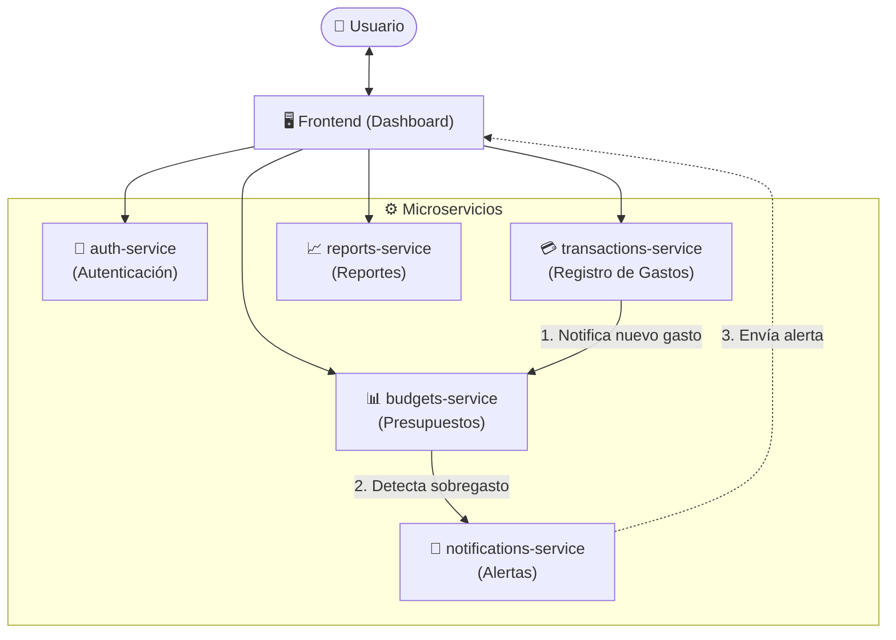

# Centavo 🪙

**Centavo** es una aplicación de finanzas personales diseñada para uso individual. Permite a los usuarios llevar un control estricto y claro de sus finanzas cotidianas mediante el registro y categorización de gastos, establecimiento y seguimiento de presupuestos, detección oportuna de sobregastos mediante alertas en tiempo real y generación periódica de reportes automatizados.

---

## 🏛️ Arquitectura del Sistema

El proyecto está organizado bajo una estructura de **monorepo**, donde coexisten el frontend (dashboard interactivo) y un conjunto de microservicios independientes, desacoplados y enfocados en un único dominio de responsabilidad.

### Diagrama de Arquitectura



---

## 🧩 Componentes del Monorepo

Cada componente reside en su propia carpeta en la raíz del repositorio:

```text
finanzasApp/
├── frontend/                 # Aplicación web / Dashboard interactivo para el usuario
├── auth-service/             # Servicio de autenticación y autorización
├── transactions-service/     # Registro, categorización y consulta de gastos
├── budgets-service/          # Definición y control de presupuestos
├── notifications-service/    # Alertas de sobregasto y notificaciones
└── reports-service/          # Generación periódica y automática de reportes
```

### 1. `frontend` (Dashboard)
- **Propósito:** Interfaz de usuario intuitiva, reactiva y moderna para la interacción diaria.
- **Responsabilidades:**
  - Registro e inicio de sesión de usuario.
  - Carga y visualización rápida de gastos con categorización visual.
  - Indicadores de progreso de presupuestos activos (barras de porcentaje, semáforos de gasto).
  - Centro de alertas de sobregasto en vivo.
  - Visualización gráfica de reportes mensuales y balances financieros.

### 2. `auth-service`
- **Propósito:** Gestión de identidad, seguridad y acceso del usuario.
- **Responsabilidades:**
  - Registro, inicio de sesión y gestión de credenciales.
  - Emisión, verificación y renovación de tokens de seguridad (JWT / tokens de sesión).
  - Garantizar el aislamiento de datos para que cada usuario acceda únicamente a su información financiera.

### 3. `transactions-service`
- **Propósito:** Núcleo transaccional para el registro y gestión de gastos cotidianos.
- **Responsabilidades:**
  - Creación, modificación, eliminación y consulta de transacciones de gasto e ingreso.
  - Gestión de categorías (e.g., Alimentación, Vivienda, Transporte, Ocio, Servicios).
  - Publicación de eventos de transacciones para que los servicios dependientes (presupuestos, notificaciones) puedan reaccionar.

### 4. `budgets-service`
- **Propósito:** Configuración, control y seguimiento de límites presupuestarios.
- **Responsabilidades:**
  - Creación y ajuste de presupuestos por período (mensual, semanal) y por categoría.
  - Cálculo del estado actual de consumo presupuestario a partir de los gastos registrados.
  - Detección de umbrales críticos de consumo (ejemplo: 80%, 100% o superación de presupuesto) y emisión de alertas.

### 5. `notifications-service`
- **Propósito:** Gestión y entrega de alertas oportunas al usuario sobre su actividad financiera.
- **Responsabilidades:**
  - Reacción inmediata a eventos de sobregasto o advertencias provenientes de `budgets-service`.
  - Entrega de notificaciones en tiempo real a la interfaz (alertas in-app) y canales secundarios (email / push).
  - Mantenimiento del historial de notificaciones leídas y pendientes.

### 6. `reports-service`
- **Propósito:** Consolidación analítica y generación periódica de balances financieros.
- **Responsabilidades:**
  - Agregación y procesamiento analítico de datos históricos de gastos y presupuestos.
  - Tareas programadas (cron jobs) para la generación de resúmenes mensuales, semanales o anuales.
  - Provisión de datos optimizados para gráficos de evolución y exportación de reportes (e.g., CSV o PDF).

---

## 🚀 Próximos Pasos

1. **Definición de stack tecnológico**: Elección de frameworks para backend (e.g., Node.js/Fastify, Go, o Python/FastAPI) y frontend (e.g., React, Next.js, Vite).
2. **Estrategia de comunicación inter-servicios**: Definir API Gateway / reverse proxy y broker de mensajería (e.g., Redis Pub/Sub, RabbitMQ) para eventos asíncronos.
3. **Scaffolding inicial del Monorepo**: Creación de los directorios de los servicios y configuración de entorno de desarrollo unificado (Docker Compose).
